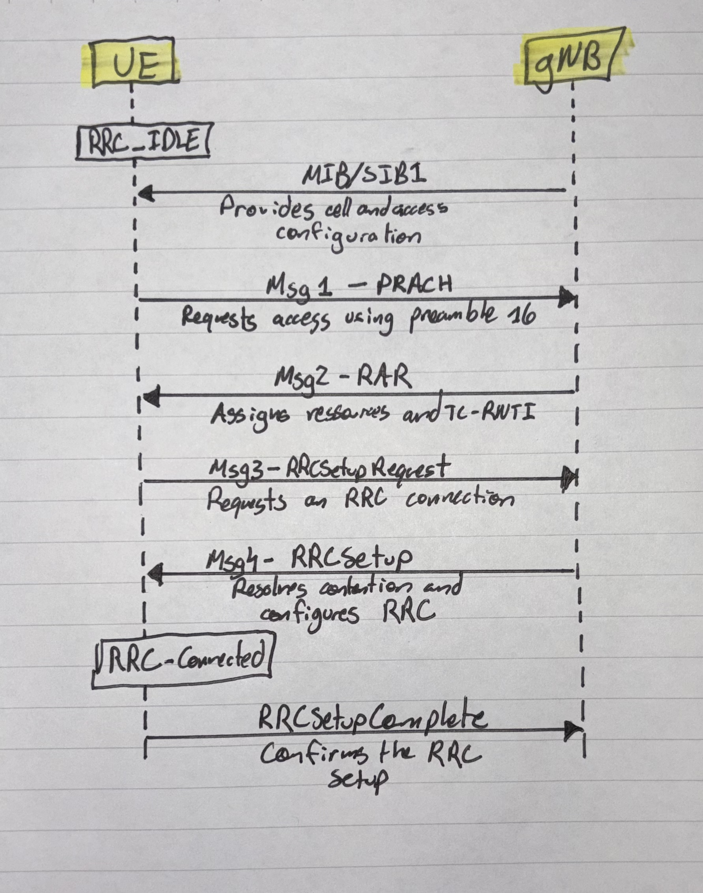

# Lab 5: From Initial Access to RRC Connection Setup (Student Guide)

## 1. Lab Goal

In Lab 1, you observed UE registration with the 5GC and the establishment of data service. This lab moves the observation point earlier: before registering with the Core network, how does a UE find a gNB, obtain cell system information, perform Random Access, and finally establish an RRC connection?

The main procedure in this lab is:

```text
Cell search / initial synchronization
→ MIB / SIB1
→ Msg1 PRACH
→ Msg2 RAR
→ Msg3 RRCSetupRequest
→ Msg4 RRCSetup
→ RRCSetupComplete
→ RRC_CONNECTED
```

This lab ends at `RRC_CONNECTED`. NAS Registration, Authentication, and PDU Session establishment belong to the Core network scope covered in Lab 1.

## 2. Evidence Used in This Lab

You will receive three files produced by the same successful OAI run:

| File | Purpose |
|---|---|
| `Lab5-ue.log` | Observe UE cell search, synchronization, PRACH, and RRC state. |
| `Lab5-gnb.log` | Cross-check gNB-side behavior when needed. |
| `Lab5.pcap` | Use Wireshark to observe MIB, SIB1, RAR, and RRC messages. |

You are not required to start OAI for this lab. Your main task is to reconstruct and explain the access procedure using the supplied log and PCAP files. Section 7 provides optional steps for reproducing the files yourself.

## 3. Learning Objectives

After completing this lab, you should be able to:

1. Explain the UE procedure from Cell Search to `RRC_CONNECTED` in the correct order.
2. Distinguish the roles of broadcast system information, Random Access, and RRC Connection Setup.
3. Obtain complementary evidence from a UE log and a Wireshark MAC-NR trace.
4. Explain the meaning of `RRC_CONNECTED` and how it differs from 5GC Registration.

## 4. Open the Supplied Files

Perform all analysis from the `openairinterface5g` repository root. Put the three supplied files in `lab5-artifacts/`, or in another location of your choice. If you use another location, adjust the paths in the commands accordingly.

```text
lab5-artifacts/Lab5-ue.log
lab5-artifacts/Lab5-gnb.log
lab5-artifacts/Lab5.pcap
```

Open `lab5-artifacts/Lab5.pcap` in Wireshark.

If Wireshark shows only UDP packets or the `nr-rrc` filter does not work, complete the following setup once:

1. Open **Analyze → Enabled Protocols...**, search for, and enable `MAC-NR-FRAMED`.
2. Open **Preferences → Protocols → MAC-NR** and enable NR RRC decoding for BCCH/CCCH data.
3. Open **Preferences → Protocols → RLC-NR** and enable RRC decoding for CCCH data and AM reassembly.
4. Close and reopen the PCAP.

## 5. Submission and Grading

Add a brief explanation below every screenshot. You do not need to draw boxes or arrows on screenshots.

### Task 1: From Cell Search to Msg2 RAR — 35 points

Complete the following four steps in order. For each step, provide the requested values or screenshots and briefly explain what the evidence shows and why it matters in the access procedure.

#### Step 1: Find Cell Search and Initial Synchronization — 8 points

Run the following command on `Lab5-ue.log`:

```bash
grep -nE 'Starting cell search|Initial sync successful' lab5-artifacts/Lab5-ue.log
```


*Cell search and initial synchronization*

Record whether UE synchronization succeeded and the PCI value. Explain: after completing initial synchronization, what is the UE able to do?

> After completing initial synchronization, the UE is synchronized with the gNB in time and frequency and has identified the physical cell. The UE can now read the cell information (MIB and SIB1) and prepare for Random Access.
#### Step 2: Find MIB and SIB1 — 8 points

In Wireshark, enter:

```text
nr-rrc
```

Find one `MIB` packet and one `SIB1` packet. Record the frame number of each and provide screenshots.


*MIB packet (frame 6)*


*SIB1 packet (frame 7)*

MIB and SIB1 are repeatedly broadcast system-information messages. The UE must obtain the common configuration before it can continue the access procedure. Briefly explain the purpose of MIB and SIB1 for UE access.

> The MIB provides basic cell information and helps the UE locate SIB1. The SIB1 provides the configuration needed to perform Random Access and access the cell.

#### Step 3: Find Msg1 PRACH — 8 points

Run the following command on the UE log:

```bash
grep -nE 'PRACH' lab5-artifacts/Lab5-ue.log
```


*Msg1 PRACH grep result*

Record the Msg1 log line number. From the line that shows the actual PRACH transmission, find:

```text
Msg1 log line number = 81
frame.slot = 553.19
preambleIndex = 16
```

Next, return to Wireshark. Clear the display filter, press `Cmd/Ctrl + F`, choose **Packet details** as the search scope, and search for:

```text
RACH Preamble chosen
```


*Wireshark - RACH Preamble chosen search*

After locating the PRACH event recorded by the gNB tracer, record:

```text
RAPID = 16
```

This packet is displayed as `MAC-LTE RACH Preamble chosen`; it is the OAI tracer MAC-event format.

Submit one UE-log screenshot and one Wireshark screenshot. Briefly answer:

1. Which Random Access message is this PRACH transmission?
> This PRACH transmission is Msg1 of the four-step Random Access procedure.
2. At which `frame.slot` and with which `preambleIndex` does the UE log show transmission?
> The UE transmits at frame.slot = 553.19 with preambleIndex = 16.
3. Does the Wireshark `RAPID` match the UE-log `preambleIndex`? What does this show?
> Yes, the Wireshark RAPID and the UE-log preambleIndex are both 16, which is consistent with the gNB detecting the preamble transmitted by the UE.

#### Step 4: Find Msg2 RAR in Wireshark — 11 points

Return to Wireshark and clear the display filter. Press `Cmd/Ctrl + F`, choose **Packet details** as the search scope, and search for `RAR` or `Random Access Response`. After locating the packet, record its frame number and find the following values in `MAC-NR RAR`:

*Wireshark - Msg2 RAR*

```text
RAPID = 16
Temporary C-RNTI = 61982
```

### Task 2: Complete Random Access and RRC Connection Setup — 40 points

Complete the following steps in order. For each message, provide a screenshot and record the requested frame number, fields, and brief explanation.

#### Step 1: Find RRCSetupRequest — 10 points

In Wireshark, use:

```text
nr-rrc.rrcSetupRequest_element
```


*Wireshark - nr-rrc.rrcSetupRequest_element filter*

Expand `UL-CCCH-Message → rrcSetupRequest` and find:

```text
Frame number = 491
Context RNTI = 61982 (0xf21e in HEX)
```

Briefly answer:

1. Does the `Context RNTI` match the `Temporary C-RNTI` in the Task 1 / Step 4 RAR? What does this show?
> Yes, both values are 61982. This shows that the UE uses the identifier assigned by the gNB during Msg2.
2. Can you claim that the RRC connection has been established after seeing only `RRCSetupRequest`? Why or why not?
> No, RRCSetupRequest only requests a connection. The UE must receive RRCSetup and send RRCSetupComplete to complete the RRC connection establishment.

#### Step 2: Find RRCSetup — 10 points

Clear the previous filter and enter:

```text
nr-rrc.rrcSetup_element
```


*Wireshark - nr-rrc.rrcSetup_element filter*

Expand `DL-CCCH-Message → rrcSetup` and find:

```text
Frame number = 492
Context RNTI = 61982 (0xf21e in HEX)
rrc-TransactionIdentifier = 1
Contention Resolution: Present
```

Check whether `Contention Resolution` also appears in the packet.

Below the screenshot, briefly answer:

1. Which message is this in four-step Random Access?
> This is Msg4 of the four-step Random Access procedure.
2. What does it mean that `Contention Resolution` and `RRCSetup` appear in the same downlink message?
> It means that the gNB resolves contention and provides the RRC connection configuration to the UE in the same message.

#### Step 3: Find RRCSetupComplete — 12 points

Clear the previous filter and enter:

```text
nr-rrc.rrcSetupComplete_element
```

Select the packet and first verify that `MAC-NR UL-SCH` appears at the top. Expand:

```text
RLC-NR → PDCP-NR → NR Radio Resource Control (RRC) protocol
  → UL-DCCH-Message → message: c1
```


*Wireshark - nr-rrc.rrcSetupComplete_element filter*

Expand `message: c1` further and confirm that it contains `rrcSetupComplete`. Record:

```text
Frame number = 498
Context RNTI = 61982 (0xf21e in HEX)
rrc-TransactionIdentifier = 1
```

Below the screenshot, briefly answer:

1. Does the `Context RNTI` still match the `Temporary C-RNTI` in the RAR?
> Yes, the Context RNTI  still match the Temporary C-RNTI (0xf21e)
2. Does the `rrc-TransactionIdentifier` match the `RRCSetup` in Step 2? What is the purpose of this comparison?
> Yes, both transaction identifiers are 1. This confirms that RRCSetupComplete corresponds to the same RRC setup procedure.

#### Step 4: Confirm the Final Random Access and RRC Connection Result — 8 points

Run the following command on the UE log:

```bash
grep -nE '4-Step RA procedure succeeded|Received NR_RRCSetup|RRCSetupComplete|State = NR_RRC_CONNECTED' \
  lab5-artifacts/Lab5-ue.log
```


*Final Random Access and Connection Result grep result*

From the output, record:

```text
4-Step RA procedure succeeded: line 87
Received NR_RRCSetup: line 88
State = NR_RRC_CONNECTED: line 90
Generating RRCSetupComplete: line 93
```

Submit a screenshot of this log output and briefly answer:

1. In log order, what are the three events from successful Random Access to generating `RRCSetupComplete`?
> The UE receives RRCSetup, enters the RRC_CONNECTED state, and generates RRCSetupComplete (lines 88, 90 and 93).
2. What do `4-Step RA procedure succeeded` and `State = NR_RRC_CONNECTED` each prove?
> 4-Step RA procedure succeeded proves that Random Access and contention resolution were successful. State = NR_RRC_CONNECTED proves that the UE has entered the connected RRC state.

### Task 3: Draw an Initial Access MSC Diagram — 25 points

Using the log and Wireshark evidence found in Tasks 1 and 2, draw your own Message Sequence Chart (MSC). It must include two vertical lifelines, `UE` and `gNB`, and the following six messages: MIB/SIB1, Msg1, Msg2, Msg3, Msg4, and `RRCSetupComplete`.

Determine and draw the correct order and direction of the messages yourself. Add a one-sentence purpose next to each arrow.


*Task 3 Diagram*

| Item | Points |
|---|---:|
| UE and gNB lifelines, with the two UE states identified | 5 |
| Complete message order: MIB/SIB1, Msg1, Msg2, Msg3, Msg4, RRCSetupComplete | 12 |
| Correct direction for every message arrow | 5 |
| Reasonable brief purpose for every major stage | 3 |
| **Task 3 subtotal** | **25** |

| Item | Points |
|---|---:|
| Task 1: Initial Access evidence timeline | 35 |
| Task 2: Key-message analysis | 40 |
| Task 3: Initial Access MSC diagram | 25 |
| **Total** | **100** |

## 7. Optional: Reproduce the Log and PCAP Files

This section is not required for the assignment. If you want to generate the same kind of evidence using your own OAI run, follow these steps in an OAI/5GC environment that was already set up in an earlier class.

The commands below assume that you are currently in the `openairinterface5g` repository root. Use three terminals and first create a directory for the artifacts:

```bash
mkdir -p lab5-artifacts
```

### Terminal A: Start the gNB and Wait for the Tracer

```bash
cd cmake_targets/ran_build/build

sudo -E env RFSIMULATOR=server ./nr-softmodem \
  -O ../../../ci-scripts/conf_files/gnb.sa.band78.106prb.rfsim.conf \
  --rfsim --T_stdout 2 \
  2>&1 | tee ../../../lab5-artifacts/Lab5-gnb.log
```

### Terminal B: Record the gNB MAC/RRC Trace

```bash
cd cmake_targets/ran_build/build

./common/utils/T/tracer/record \
  -d ../../../common/utils/T/T_messages.txt \
  -o ../../../lab5-artifacts/Lab5-gnb-wireshark.raw \
  -on WIRESHARK
```

The gNB in Terminal A continues after the tracer connects.

### Terminal C: Start the UE and Save the UE Log

```bash
cd cmake_targets/ran_build/build

sudo -E RFSIMULATOR=127.0.0.1 ./nr-uesoftmodem \
  -O ../../../targets/PROJECTS/GENERIC-NR-5GC/CONF/ue.conf \
  --rfsim -r 106 --numerology 1 --band 78 -C 3619200000 \
  2>&1 | tee ../../../lab5-artifacts/Lab5-ue.log
```

After `State = NR_RRC_CONNECTED` appears, wait a few seconds, then stop the terminals in this order: recorder in Terminal B, UE in Terminal C, and gNB in Terminal A.

### Convert the Trace to a Wireshark PCAP

```bash
cd cmake_targets/ran_build/build

./common/utils/T/tracer/macpdu2wireshark \
  -d ../../../common/utils/T/T_messages.txt \
  -i ../../../lab5-artifacts/Lab5-gnb-wireshark.raw \
  -to-file ../../../lab5-artifacts/Lab5.pcap
```

You should obtain:

```text
lab5-artifacts/Lab5-ue.log
lab5-artifacts/Lab5-gnb.log
lab5-artifacts/Lab5.pcap
```
